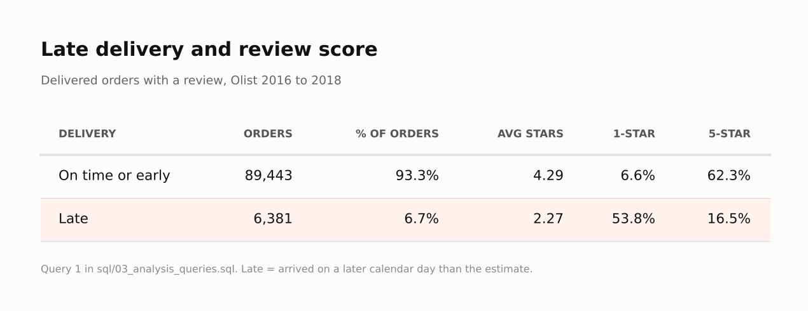
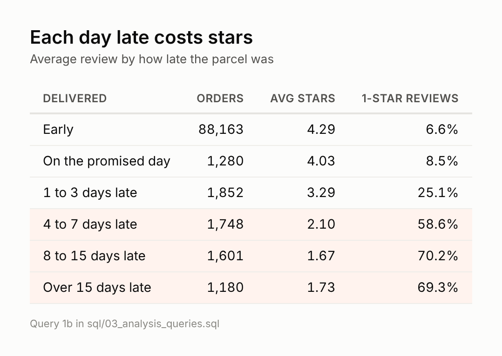
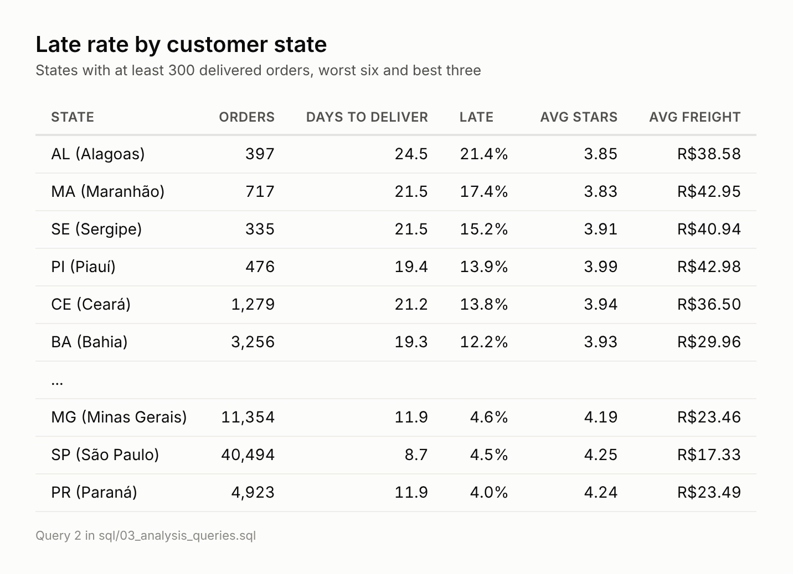
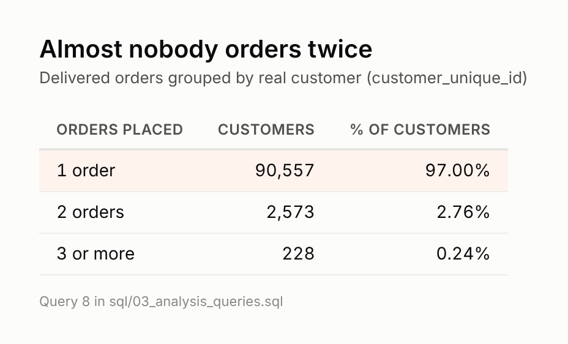

# Findings

Scope: 96,470 delivered orders with a valid delivery date, September 2016 to August 2018. 93,350 customers, R$13.2M in item revenue plus R$2.2M freight. Every number comes from `sql/03_analysis_queries.sql`; the raw output is in `results/analysis_output.txt`. Review statistics use the 95,824 delivered orders that have a review. "Late" means the parcel arrived on a later calendar day than the estimated date.

## 1. Late delivery is the single biggest driver of bad reviews

93.3% of reviewed orders arrive on time or early and average 4.29 stars. The 6.7% that arrive late average 2.27. A late parcel is about eight times more likely to get a one-star review (53.8% against 6.6%).

Late orders are a small slice of deliveries but produce 36.7% of all one-star reviews.

## 2. Every extra day late costs stars, and the score bottoms out after a week

| Delivered | Orders | Avg stars | One-star |
| --- | --- | --- | --- |
| Early | 88,163 | 4.29 | 6.6% |
| On the promised day | 1,280 | 4.03 | 8.5% |
| 1 to 3 days late | 1,852 | 3.29 | 25.1% |
| 4 to 7 days late | 1,748 | 2.10 | 58.6% |
| 8 to 15 days late | 1,601 | 1.67 | 70.2% |
| Over 15 days late | 1,180 | 1.73 | 69.3% |

The first three days of lateness cost about one star. The next four cost another. After a week the average sits near 1.7 and does not fall further. The practical message: the window to act is in the first three days.

## 3. Most of the extra time is in transit, not at the seller

| | Seller handling (days) | In transit (days) | Promised (days) |
| --- | --- | --- | --- |
| On-time orders | 3.0 | 7.9 | 24.5 |
| Late orders | 6.0 | 27.9 | 23.3 |

Sellers do take twice as long on late orders, but that is three extra days. The courier leg takes twenty extra days. If Olist wants to fix lateness, the main conversation is with carriers. Late orders were also not promised longer than on-time ones (23.3 days against 24.5), so the estimates were not padded for them.

## 4. Geography explains a large part of it

São Paulo, which is 42% of all orders, gets parcels in 8.7 days with a 4.5% late rate and 4.25 average stars. The North and North-East states average 20.4 days to deliver (North 22.5, North-East 19.9). The worst late rates:

| State | Orders | Days to deliver | Late | Avg stars |
| --- | --- | --- | --- | --- |
| Alagoas (AL) | 397 | 24.5 | 21.4% | 3.85 |
| Maranhão (MA) | 717 | 21.5 | 17.4% | 3.83 |
| Sergipe (SE) | 335 | 21.5 | 15.2% | 3.91 |
| Piauí (PI) | 476 | 19.4 | 13.9% | 3.99 |
| Ceará (CE) | 1,279 | 21.2 | 13.8% | 3.94 |
| São Paulo (SP) | 40,494 | 8.7 | 4.5% | 4.25 |

These are also the states where freight takes the largest share of the bill: 20.8% in Maranhão, 19.5% in Piauí and Sergipe, against 12.2% in São Paulo. Customers there pay more and wait longer.

## 5. A short list of sellers carries a lot of the problem

Among the 210 sellers with at least 100 delivered orders, the worst late rate is 19.0% (a seller in Maranhão, 389 orders). One São Paulo seller with 108 orders has a 16.7% late rate and an average review of 2.39, the lowest in the top ten. Seller revenue in this query is summed from each seller's own item lines, so multi-seller orders are not double counted. The list is ten names, which is a manageable conversation.

## 6. Revenue grew fast, with a clear Black Friday spike

Monthly revenue from delivered orders went from R$112k in January 2017 to R$839k in August 2018. November 2017 jumped 52% on October to R$988k, the highest month in the data, then fell 26.5% in December. Through 2018 monthly revenue plateaued, ranging from R$0.83M to R$0.98M.

## 7. Health and beauty earns the most; bed, bath and table reviews worst

| Category | Orders | Revenue | Share | Avg stars |
| --- | --- | --- | --- | --- |
| Health & beauty | 8,647 | R$1.23M | 9.3% | 4.19 |
| Watches & gifts | 5,493 | R$1.17M | 8.8% | 4.07 |
| Bed, bath & table | 9,272 | R$1.02M | 7.7% | 3.92 |
| Sports & leisure | 7,529 | R$0.95M | 7.2% | 4.17 |
| Computer accessories | 6,529 | R$0.89M | 6.7% | 3.99 |

Bed, bath and table has the most orders of any category but the lowest reviews of the top ten. Worth a look at whether that is a product quality issue or a packaging and damage issue.

## 8. Three quarters pay by credit card, and instalments go with bigger orders

75.2% of orders are paid by credit card, and 66.9% of those use instalments (3.5 on average). Boleto (a Brazilian bank slip) is 19.5%. Among credit card orders, the more instalments, the larger the order:

| Instalments | Orders | Average order value |
| --- | --- | --- |
| 1 (upfront) | 25,335 | R$96 |
| 2 to 3 | 22,792 | R$135 |
| 4 to 6 | 16,205 | R$182 |
| 7 or more | 12,173 | R$336 |

This shows that bigger purchases are spread over more instalments. It does not show that offering instalments makes people spend more.

## 9. Almost nobody buys twice

97.0% of customers placed exactly one order. 2.76% placed two, and 0.24% placed three or more. This is the number I would show a chief executive first.

Does a late first order make it worse? To compare fairly, I only counted customers whose first order was placed before July 2017, so everyone had at least a year to come back. Of 13,319 customers whose first order was on time, 5.1% came back. Of 536 whose first order was late, 3.4% came back. The pattern points the expected way, but the late group is small, and this does not prove that lateness caused the difference.

## Data quality log

The cleaning script records seven issues in `dq_log`: 610 products without a category, 8 delivered orders with no delivery date, 3 payments with an undefined method, 551 orders with duplicate reviews, 2 categories without an English name, 775 orders with no item lines, and 3,345 customer ids that belong to repeat customers.
