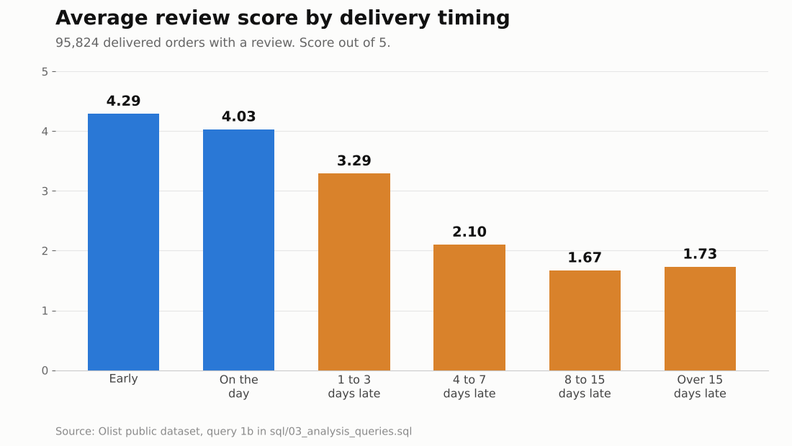
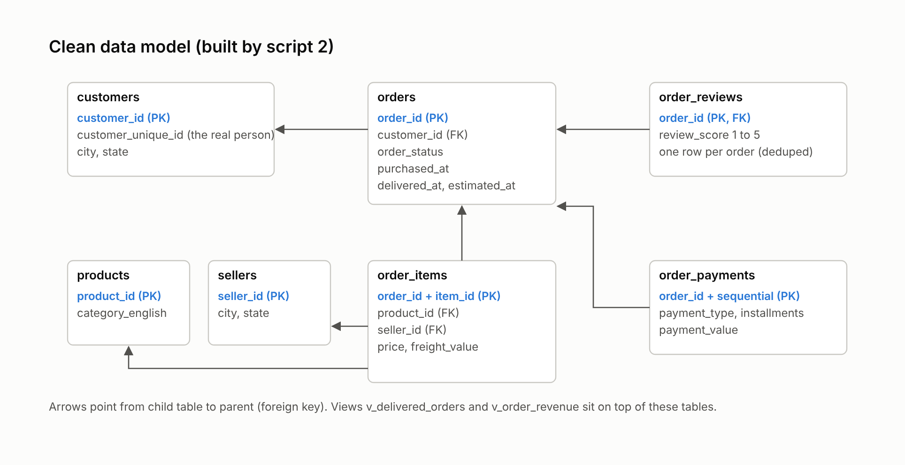
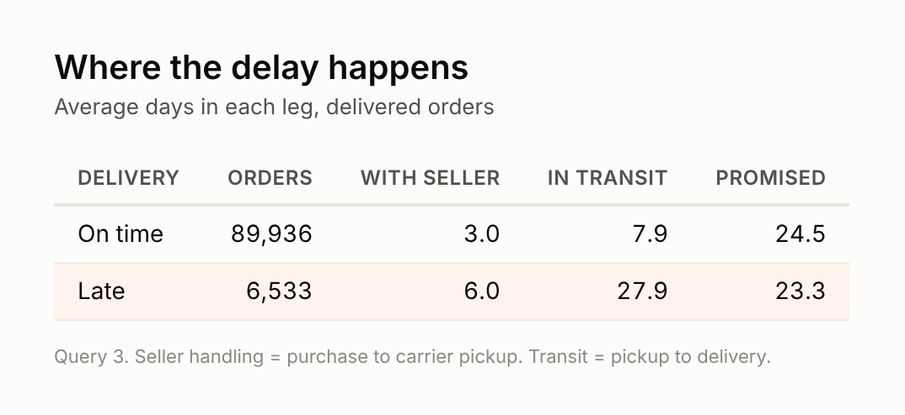

# Olist E-Commerce: Why Late Deliveries Cost Reviews (MySQL)

A SQL project on about 100,000 real orders from Olist, a Brazilian online marketplace. I loaded nine raw CSV files into MySQL, cleaned and modelled them, and used the result to answer one question that matters to any marketplace: what happens to customer reviews when a parcel is late?



## The short version

Orders that arrive on time or early average 4.29 stars. Orders that arrive late average 2.27. Once a parcel is more than a week late, about seven in ten customers leave a one-star review. Late orders are only 6.7% of delivered orders with a review, but they produce 36.7% of all one-star reviews.

Most of the delay happens after the parcel leaves the seller. Late orders spend 6 days with the seller (against 3 for on-time orders) but 28 days in transit (against 8). The slowest regions are the North and North-East of Brazil, where parcels take about 20 days on average compared with 9 days in São Paulo.

## The data

Olist published this dataset on Kaggle. It is real, anonymised commercial data covering September 2016 to August 2018.

| Table | Rows | What it holds |
| --- | --- | --- |
| orders | 99,441 | One row per order with status and five timestamps |
| order_items | 112,650 | One row per item, with price, freight and seller |
| order_payments | 103,886 | Payment method, instalments, amount |
| order_reviews | 99,224 | Review score 1 to 5, with optional comment |
| customers | 99,441 | Customer location (one row per order) |
| products | 32,951 | Category and dimensions |
| sellers | 3,095 | Seller location |
| geolocation | 1,000,163 | Zip prefix to coordinates (loaded, not used) |
| category translation | 71 | Portuguese to English category names |

Source: [Brazilian E-Commerce Public Dataset by Olist](https://www.kaggle.com/datasets/olistbr/brazilian-ecommerce), licence CC BY-NC-SA 4.0. The CSV files are not included in this repository because of their size; download them from Kaggle.

## What I had to fix before analysis

The data looks clean at first glance. It is not.

- **`customer_id` is not a customer.** It is one row per order. The real person is `customer_unique_id`, which collapses 99,441 ids down to 96,096 people. Any repeat-purchase analysis that uses the wrong column will say nobody ever comes back.
- **551 orders have more than one review**, and 814 review ids appear more than once. I kept the most recent review per order using `ROW_NUMBER()`.
- **610 products have no category** and 2 categories have no English translation. Both are handled, not dropped.
- **775 orders have no item lines.** They are kept in the orders table and left out of revenue analysis.
- **The estimated delivery date is stored at midnight.** Comparing full timestamps would mark a parcel delivered on the promised day at 3pm as late. I compare calendar dates instead. Among reviewed orders this changes the late rate from 8.0% to 6.7% and the late-order average review from 2.57 to 2.27, so the definition matters.
- **8 delivered orders have no delivery date.** Left as NULL and excluded from timing analysis.
- **Two of the CSV files use Windows line endings** (reviews and category translation) while the other seven use Unix endings. The load reads lines ending in `\n`, so a hidden carriage return stays on the last column of those two tables. The cleaning script strips it.
- **Two column names are misspelled in the source** (`product_name_lenght`, `product_description_lenght`). They are renamed in the clean tables.
- **Dates are converted with an explicit format** (`STR_TO_DATE(..., '%Y-%m-%d %H:%i:%s')`). Implicit conversion failed with Error 1292 on my MySQL 8.0 server, even though every date in the orders staging table was a clean 19 characters.

Every data quality decision is written to a `dq_log` table by the cleaning script, so anyone can see what was changed and why.

## Method

1. `sql/01_create_and_load_raw.sql` creates the database and loads every CSV into text-only staging tables. Nothing is rejected on load.
2. `sql/02_clean_data.sql` builds typed tables with primary and foreign keys, de-duplicates reviews, joins category translations, and creates two views: `v_delivered_orders` (one row per delivered order with timing and review) and `v_order_revenue`.
3. `sql/03_analysis_queries.sql` answers nine business questions.



SQL used: CTEs, window functions (`ROW_NUMBER`, `LAG`, `SUM OVER`, `COUNT OVER`), conditional aggregation, `DATEDIFF`, multi-table joins, `HAVING` to filter small groups, views, foreign keys.

## Findings

Full detail in [FINDINGS.md](FINDINGS.md).



| Question | What the data says |
| --- | --- |
| Does lateness hurt reviews? | On time: 4.29 stars, 6.6% one-star. Late: 2.27 stars, 53.8% one-star. |
| How fast does it get worse? | 1 to 3 days late: 3.29 stars. 4 to 7 days: 2.10. Over a week: about 1.7. |
| Where does the delay happen? | Late orders: 6 days with the seller, 28 in transit. On time: 3 and 8. Most of the extra time is in transit. |
| Which regions? | Alagoas 21.4% late, Maranhão 17.4%. São Paulo 4.5%. North and North-East about 20 days to deliver against 9 in São Paulo. |
| Worst sellers? | Of 210 sellers with 100+ delivered orders, the worst has a 19.0% late rate. One São Paulo seller sits at 2.39 stars. |
| Top categories? | Health & beauty leads (R$1.23M, 9.3% of revenue). Bed, bath & table has the most orders but the lowest reviews of the top ten (3.92). |
| Growth? | Revenue grew from R$112k (Jan 2017) to R$839k (Aug 2018). November 2017 peaked at R$988k, up 52% on October. |
| Payment? | 75% pay by credit card; two thirds of those use instalments (3.5 on average). Orders paid in 7 or more instalments average R$336, against R$96 for one payment. |
| Repeat buyers? | 97% of customers ordered once. |
| Freight? | Freight is 12% of the bill in São Paulo and 21% in Maranhão. |

## What I would do with this

1. Set courier service levels by region. Most of the extra time is in transit, so the North-East needs a different promise or a different carrier.
2. Warn customers early. A parcel that is 1 to 3 days late still gets 3.3 stars. The same parcel at 8 days late gets 1.7. Proactive messaging in that window is cheap.
3. Review the sellers with the highest late rates. It is a short list and a large share of complaints.
4. Treat the 3% repeat rate as the biggest commercial opportunity in the data.

## Limitations

- Reviews are only attached to delivered orders, so cancelled orders say nothing here.
- The geolocation table is loaded but not used; a distance-based analysis would be a natural next step.
- Review scores reflect the whole experience, not only delivery. The relationship is strong but the data cannot prove cause.
- The repeat-purchase comparison by first-order delivery has only 536 late first orders in the fair-comparison group, so treat it as indicative.
- Data ends in August 2018. Olist's logistics have likely changed since.

## How to run it

You need MySQL 8 and MySQL Workbench. Allow 15 minutes.

1. Download the dataset from Kaggle and unzip it into a folder with a simple path, for example `D:/olist/`. The CSV files must sit directly inside that folder.
2. In Workbench, go to Database > Manage Connections, pick your connection, open the Advanced tab, and add `OPT_LOCAL_INFILE=1` on its own new line in the Others box (leave the lines already there). Close the connection tab and open a fresh connection from the home screen. The setting only applies to a new connection.
3. Open `sql/01_create_and_load_raw.sql`. Use Find and Replace to change `D:/olist/` to your folder (forward slashes). Run the whole script. The final result shows nine row counts that must match the expected column.
4. Run `sql/02_clean_data.sql`. The last two results are the table row counts and the data quality log.
5. Open `sql/03_analysis_queries.sql` and run each query with Ctrl+Enter.

Common errors:

- **Error 2068** (local data loading disabled): the connection setting in step 2 has not taken effect. Add it, close the connection tab and reconnect. Also check `SHOW VARIABLES LIKE 'local_infile';` returns ON.
- **Error 3948 or 1148:** same cause. Run `SET GLOBAL local_infile = 1;` as an admin user.
- **Empty results in script 3:** script 1 did not load the data, so scripts 2 and 3 ran on empty tables. Check the final grid of script 1.

## Repository structure

```
olist-ecommerce-sql/
├── README.md
├── FINDINGS.md
├── sql/
│   ├── 01_create_and_load_raw.sql
│   ├── 02_clean_data.sql
│   └── 03_analysis_queries.sql
├── images/             # result screenshots used in the write-up
└── results/
    └── analysis_output.txt
```

## Author

Frank Uyaemesi, Data Analyst
